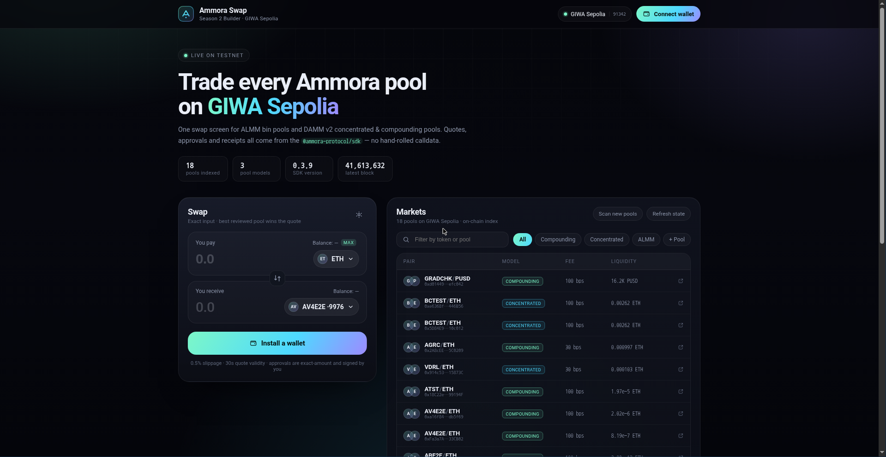

# Ammora Swap — GIWA Sepolia DEX

A focused swap front end for [Ammora](https://github.com/ammora-labs/ammora-protocol) liquidity, built with the
official [`@ammora-protocol/sdk`](https://www.npmjs.com/package/@ammora-protocol/sdk) (`0.3.9`) and
[viem](https://viem.sh). Everything runs client-side on **GIWA Sepolia** (chain ID `91342`).

- Live app: https://jyjmessi.github.io/ammora-swap/
- Network: GIWA Sepolia · RPC `https://sepolia-rpc.giwa.io` · Explorer `https://sepolia-explorer.giwa.io`



## What it does

| Area | Implementation |
| --- | --- |
| Wallet | Any injected EIP-1193 wallet (MetaMask, Rabby, …). The header always reads **Connect Wallet** and the swap card offers **Install a wallet** when no provider is detected. One-click `wallet_switchEthereumChain` for GIWA Sepolia with a `wallet_addEthereumChain` fallback (error `4902`). **Disconnect** clears the app session and asks the wallet to forget the origin via EIP-2255 `wallet_revokePermissions`; wallets without it keep the local disconnect (remembered so a reload does not auto-reattach) until the user connects again. |
| Theme | Light/dark toggle in the header. Surfaces, hairlines and accents come from CSS theme tokens (`:root[data-theme='light']`); the choice is stored as `ammora-swap-theme` and applied before first paint. |
| Markets | Live pool state read through `ALMMClient` (bin step, active bin, fee) and `DammV2Client` (sqrt price, reserves, fee) for **concentrated**, **compounding** and **ALMM** pools. |
| Pool discovery | Bundled on-chain index of the reviewed factory `PoolCreated` events, plus `discoverAmmoraPools()` factory-log scans for new pools and manual pool import. |
| Protocol index | `AmmoraDataApiClient('https://ammora-giwa-sepolia-data.fly.dev')` seeds the market list when the API answers; the app falls back to on-chain reads when it does not. |
| Quotes | `AmmoraSwapClient.prepareExactIn()` for every pool that connects the pair; the highest `expectedAmountOut` wins. 30-second quote validity, exact-input only. |
| Execution | `PreparedExactInputSwap.execute()` handles the whole lifecycle: exact-amount ERC-20 approvals, simulation at the approval block, submission, receipt decoding and output-balance verification. |
| Native value | ETH in/out goes through the reviewed native router for DAMM v2 pools. ALMM bin pools settle the wrapped-native ERC-20, so ETH routes skip them and WETH is listed as its own token. |
| Safety rails | Per-quote slippage (0.1–50%), minimum-received shown before signing, price impact, partial-fill warnings, explorer links for every transaction. |

Every address used by the app comes from the SDK's reviewed GIWA Sepolia catalog
(`ammoraRouteDeployments[91342]`). The SDK re-checks pool provenance against the reviewed factory before an
allowance is signed.

## Run locally

```bash
npm install
npm run dev      # http://localhost:5173
npm run build    # type-check + production bundle in dist/
npm run preview  # serve the production bundle
```

`vite.config.ts` sets `base: './'`, so the same build works at `/ammora-swap/` on GitHub Pages and at the root of
any other static host.

## Project layout

```
src/
  chain.ts        GIWA Sepolia chain definition, explorer helpers
  wallet.ts       EIP-1193 connection, network switch/add, viem wallet client
  ammora.ts       shared public client, swap client, pool-state and token readers
  pools.ts        bundled index, factory-log scan, Data API, pool import
  quote.ts        multi-pool exact-input quoting and route selection
  tokens.ts       token registry and amount formatting/parsing
  components/     SwapCard, MarketsPanel, TokenSelect, icons
  data/pools.json generated pool + token index (see scripts/sync-pools.mjs)
```

## Refreshing the bundled pool index

`scripts/sync-pools.mjs` rebuilds `src/data/pools.json` from the reviewed factories: it reads `PoolCreated`
logs, then asks each pool for live state and each token for its metadata.

```bash
node scripts/sync-pools.mjs
```

The app also scans recent factory logs at runtime (`Scan new pools`), so a redeploy is only needed to refresh the
historical index.

## Deployment

The live site is published from the `gh-pages` branch:

```bash
./scripts/deploy-gh-pages.sh    # builds and force-pushes dist/ to gh-pages
```

GitHub Pages serves that branch at the repository path (`base: './'` keeps every asset relative). No server-side
code is involved — the whole app is static files plus RPC calls from the browser.

## Notes and limits

- **Testnet only.** Ammora has not announced a mainnet deployment or completed an independent audit. Nothing here
  is financial advice and no real funds are involved.
- Exact-input swaps only; exact-output, zaps, liquidity provisioning and launching are not part of this UI.
- Pool liquidity on GIWA Sepolia is test liquidity; some pools are empty and will report "no route".
- Token symbols and decimals are read from the token contracts themselves.
- The Ammora Data API may be offline; the UI says so and keeps working from chain reads.

## License

MIT
